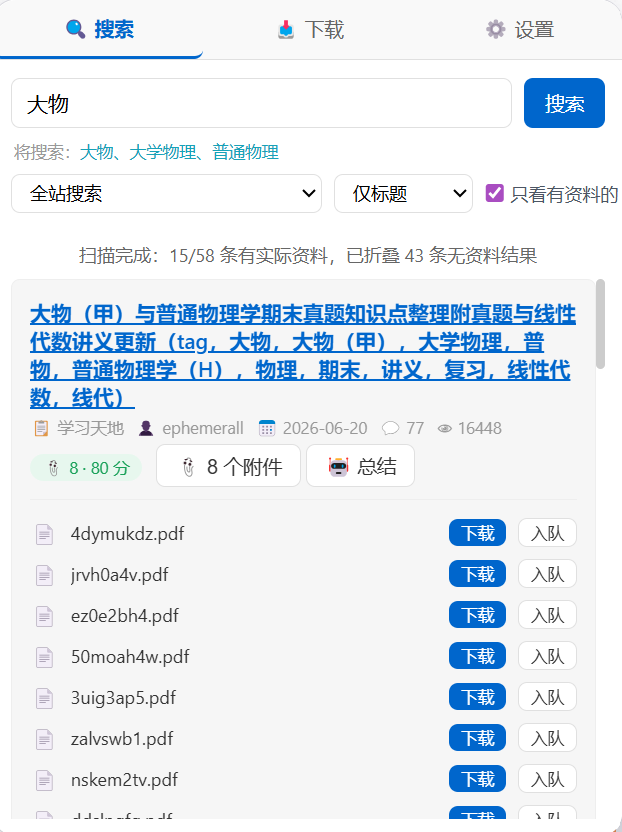
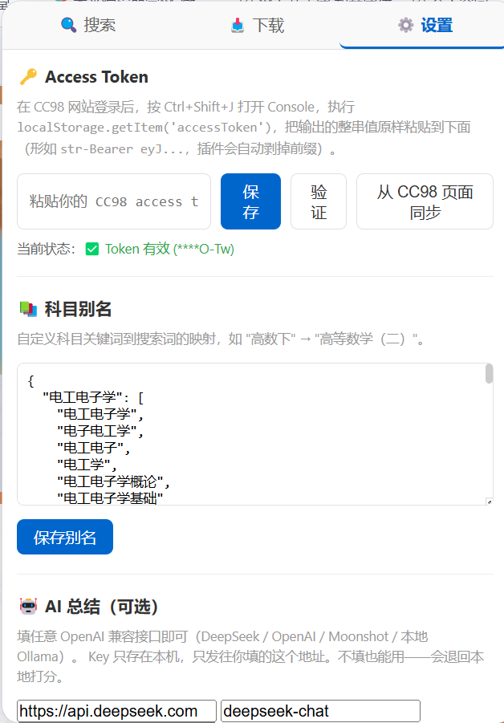

# CC98 科目资料检索

[](https://github.com/gvvg5272-code/cc98-material-search/releases/latest)
[](LICENSE)
[](https://www.google.com/chrome/)

> 在 CC98 论坛里按科目找到**真正有资料**的帖子，而不是一堆「求一份讲义」。

一个 Chrome / Edge 扩展（Manifest V3）。只读：搜索、读帖、下载附件，不发帖不回帖。

**👉 [点这里下载最新版](https://github.com/gvvg5272-code/cc98-material-search/releases/latest)** —— 下载 zip，解压后按下方「安装」三步加载即可。

---

## 界面预览

搜「大物」，58 条结果里自动筛出 **15 条真有附件**，其余 43 条被折叠：



扫描是逐条推进的，能实时看到进度：


设置页（Token 自动同步、科目别名、AI 接口）：



---

## 为什么需要它

CC98 自带的搜索按关键词匹配标题。搜「数据结构」，返回的 20 条里通常是这样的构成：

```
长期三折出书（部分赠送资料）…           ← 卖书
求一本数据结构实验教程                    ← 求书
数据结构与算法分析（c语言描述）fds教材 出  ← 卖书
高级数据结构与算法分析 讲义分享           ← 真正的资料（1 条）
```

实测**10 条里只有 1 条真有附件**。而且真正的资料帖标题往往不含课程名（叫「XX 资源楼」「XX 课程总结」），关键词搜索根本捞不到。

这个扩展做三件原站做不到的事：

1. **自动分拣**——扫每条结果的楼主帖，把卖书帖、求书帖、水帖折叠掉
2. **多楼层找附件**——资源楼的资料常常在 2、3 楼，而不是楼主那层
3. **AI 总结**（可选）——读正文 + 附件清单 + 作者风评值，告诉你「这份资料是什么、缺什么、值不值得下」

---

## 功能

| 功能 | 说明 |
|---|---|
| 别名扩展搜索 | 配好「电工电子学 → 电子电工学 / 电工电子 / 电工学…」，一次搜索打多个词 |
| 自动分拣 | 分四类：**卖书 / 求资料 / 资源 / 讨论**，可一键折叠噪音 |
| 附件解析 | 识别正文里的 Markdown 链接与 `file.cc98.org` 直链，用链接文字当文件名 |
| AI 总结 | 支持任意 OpenAI 兼容接口（DeepSeek / OpenAI / Moonshot / 本地 Ollama） |
| 本地打分 | 不配 AI 也能用：按附件数、收藏、回复、作者风评值算分，逐条列出依据 |
| 批量下载 | 队列下载，失败重试，文件名自动清洗 |
| Token 自动同步 | 直接读已登录页面的 `localStorage`，不用手动复制粘贴 |

---

## 安装

1. 下载或克隆本仓库
2. Chrome 打开 `chrome://extensions`（Edge 是 `edge://extensions`）
3. 打开右上角「**开发者模式**」
4. 点「**加载已解压的扩展程序**」，选择本仓库目录
5. 工具栏出现插件图标即成功

> 需要 **Chrome 102+**（用到了 `chrome.storage.session`）。

---

## 使用

### 1. 同步登录凭据

先打开 https://www.cc98.org 并**确认已登录**。然后点插件图标——它会在打开时自动从 CC98 页面读取 Token。

如果没读到，到「⚙️ 设置」点「**从 CC98 页面同步**」。

<details>
<summary>手动获取 Token（备用方式）</summary>

在 CC98 页面按 `Ctrl + Shift + J` 打开 Console，执行：

```javascript
localStorage.getItem('accessToken')
```

复制输出的整串值，粘贴到插件设置页。注意：

- 键名是 `accessToken`（驼峰），不是 `access_token`
- 值形如 `str-Bearer eyJhbGciOi...`，是「4 字符前缀 + `Bearer ` + JWT」两层包装，插件会自动剥掉
</details>

### 2. 搜索

输入科目关键词 → 选结果条数（20 / 60 / 100）→ 回车。

搜索后插件会**自动逐条扫描**，状态栏显示进度：

```
正在自动筛选 12/60（已找到 3 条有资料）
```

扫完后按 **资源楼 > 有附件 > 分数 > 回复数** 重排，并折叠无资料的结果。

每条结果上的标签：

| 标签 | 含义 |
|---|---|
| `资源 📎 12 · 80 分` | 资源/汇总帖，12 个附件，本地评分 80 |
| `📎 3 · 55 分` | 普通分享帖，3 个附件 |
| `求资料` | 在求资料，不是分享 |
| `卖书` | 出书 / 二手交易帖 |
| `无附件` | 前 20 层里没找到附件链接 |

### 3. 下载

点「📎 查看附件」展开文件列表，逐个下载或加入队列。

> 实测 `file.cc98.org` 的文件公开可下载，不需要 Token，所以下载走浏览器原生下载器。

### 4. AI 总结（可选）

到「⚙️ 设置 → 🤖 AI 总结」填三个字段：

| 服务 | 地址 | 模型名示例 |
|---|---|---|
| DeepSeek | `https://api.deepseek.com` | `deepseek-chat` |
| 月之暗面 | `https://api.moonshot.cn` | `moonshot-v1-8k` |
| OpenAI | `https://api.openai.com` | `gpt-4o-mini` |
| 本地 Ollama | `http://localhost:11434` | `qwen2.5:7b`（Key 随便填） |

点「保存」（会弹一次权限请求，允许访问该域名）→ 点「测试连接」确认可用。

然后在任意结果上点「🤖 总结」，输出：

- **类型**：分享 / 求资料 / 讨论 / 其他
- **推荐度**：1–5 星
- **一句话结论**
- **包含**：这份资料实际有什么
- **缺少 / 注意**：缺哪几章、有什么坑
- **建议**

没配 AI 时点同一个按钮，会显示**本地打分**和逐条依据，功能不会因为没配 key 而失效。

---

## 数据与隐私

- **无遥测**，不向任何服务器上报数据
- Token 存在 `chrome.storage.local`，只有本机可读
- 网络请求只发往：`api.cc98.org`（接口）、`file.cc98.org`（文件）、以及**你自己填的 AI 接口地址**
- AI 总结会把帖子标题、楼主正文（截断 6000 字）、附件名、部分回复发给**你配置的那个 AI 服务**——如果介意，别配 AI，本地打分不联网

---

## 合规与限制

本扩展**只读**，并刻意做了以下收敛：

- 不发帖、不回帖、不点赞、不评分
- 不绕过登录、验证码、付费、回复可见、积分限制
- 搜索请求间隔 ≥2.5 秒（实测更短会稳定 403），下载间隔 ≥1 秒

已知限制：

| 限制 | 原因 |
|---|---|
| 需要校园网或 IPv6 | `api.cc98.org` 是校内服务 |
| 搜索较慢（每页约 3 秒） | 搜索接口限流严格；`size` 上限固定 20，想多要只能翻页 |
| 分拣只扫前 20 层 | 资源楼的资料若在 21 楼以后会漏 |
| 搜索接口 `condition` 参数疑似无效 | 实测「标题」与「标题+内容」返回完全一样 |
| 帖子点赞字段常年为 0 | 质量信号实际靠「收藏数」和「作者风评值」 |
| 附件名可能是随机串（如 `4dymukdz.pdf`） | 取决于楼主怎么贴链接：用 `[讲义](url)` 这种带文字的 Markdown 链接就能显示成「讲义.pdf」，贴裸链接就只能取 URL 末段 |

---

## 开发

```
manifest.json          MV3 配置
lib/
  cc98-api.js          API 封装（频率锁、错误分类）
  search.js            别名展开、翻页、聚合排序
  attachment.js        附件解析（Markdown 链接 + 遗留 UBB 兼容）
  triage.js            分拣规则（分类、筛选、排序）
  ai.js                AI 调用 + 本地打分
  download-queue.js    下载队列
  sanitize.js          HTML 转义、文件名清洗
  token.js             Token 归一化
popup/                 三标签页 UI
background/            Service Worker
scripts/               接口验证、帖子解剖、附件自检等工具
test/                  离线回归 + 在线接口测试
```

```bash
node test/regression.test.mjs     # 离线回归，46 项，不联网
node test/api-verify.test.mjs     # 真实接口测试，无 Token 时自动跳过认证用例
```

调试工具：

```bash
node scripts/api-verify.mjs --token <token>                  # 三大链路验证
node scripts/dump-topic.mjs --token <t> --url <帖子链接>       # 把帖子正文原样倒出来
node scripts/check-attachments.mjs --token <t> --topic <id>   # 附件链路自检
```

开发笔记（踩过的坑、接口字段的真实形态、为什么这么写）见 [HANDOFF.md](HANDOFF.md)。

---

## License

MIT
